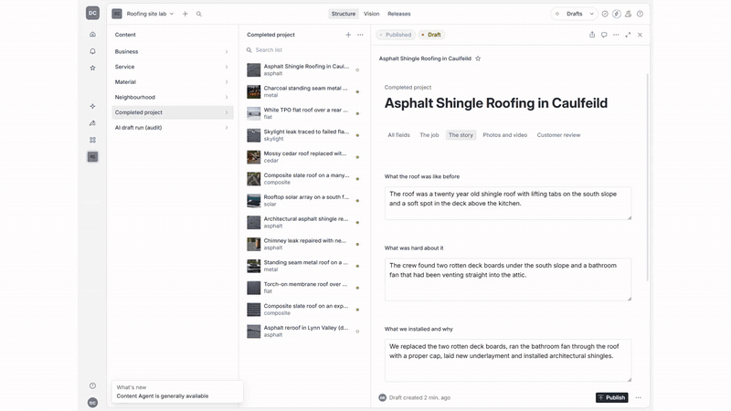

# Roofing Site Lab

[](https://github.com/Exalt24/roofing-site-lab/actions/workflows/test.yml)



*Left to right in the clip: an AI-written draft waiting for a person in Sanity Studio, then the live static site that is built from the same content. [Full quality mp4](docs/demo.mp4).*

Astro and Sanity reference site for a roofing contractor, with AI drafts for human review. Sample data. Live site: https://seabreeze-roofing-lab.pages.dev

**Everything here is sample data.** "Seabreeze Roofing & Solar" is an invented company, the jobs, people, reviews, licence and insurance details, phone number and addresses are made up, and every photograph is a synthetic image generated locally (SDXL through ComfyUI) with its metadata stripped. The clips are 6 second synthetic placeholders. Nothing is a real customer, a real roof or a real result. **The quote form on the live sample is not connected to anything** (the page says so and the button is disabled): the lead receiver is built and tested here but is not deployed.

For the person who would run this for a real company, start with [docs/HANDOVER.md](docs/HANDOVER.md).

## What it does

A roofer's crew finishes a job, picks the photos and fills a short intake (what the roof was like, what was hard, what was installed). The system turns that into a draft project page in Sanity Studio. A person reads it, fixes it and presses Publish. The site is rebuilt as static HTML from the published content.

- **Content model, one entry per job.** A completed project is entered once. Service, material and neighbourhood pages are derived from the projects, so they cannot drift apart. A neighbourhood page only exists when it has at least 2 finished projects and at least 25 words of local facts; otherwise the page is not generated and the build log says why.
- **Build gates.** The build refuses to ship when the page graph breaks: orphan pages, dead links, an area page that could be swapped for another area by changing the place name (swap test), or near-duplicate pages. Each gate has a test that fails when the gate is removed.
- **AI drafting with a human in the loop.** The model writes only structured JSON against a schema, from a facts ledger with ids. Each section has to cite the entered facts it used (citation is per section, not per sentence). Deterministic validators then check numbers, names, materials, banned claims, personal data, lengths, near-duplicates and a prompt-injection canary. Missing details are computed in code and shown as "missing information" rather than invented. The writer can only create `drafts.*` documents, so nothing the model writes can go live without a person, and a re-run never overwrites a draft someone has edited.
- **What the AI step receives.** The job's entered fields, the staff notes and photo captions, and the photos. The private block (customer name, phone, email, street address) is never sent. If an employee types one of those into a free-text box anyway, the intake is refused before any model call and the message names the box. Uploaded photos have their EXIF (GPS, device, time) removed first. The default model runs locally through Ollama, so nothing leaves the machine; a hosted model is an option the company would have to choose.
- **Call tracking plumbing.** A webhook receiver for CallRail's post-call format (HMAC-SHA1 `Signature` header, checked against the RFC 2202 test vector), E.164 phone normalisation, click ids pulled from the landing page URL, a SQLite ledger with idempotent inserts (the raw payload is cut down to an allow-list of fields; the lead row itself keeps the phone number in E.164, the landing page URL and the GA client id), an outbox with backoff that gives up after 12 tries, a daily retention purge that zeroes the deleted rows in the file and vacuums it, and a reconcile at start-up and nightly because CallRail does not resend failed webhooks. `npm run start -w packages/tracking` runs it. Output goes to GA4 (Measurement Protocol) and to Google Ads through the **Data Manager API**, because new offline-conversion work can no longer use the Google Ads API upload route (restricted from 2026-06-15). The Ads builder measures click age to the day of the upload, drops a click id older than 90 days, stops matching on phone and email after 63, and builds requests with `validateOnly` on by default.
- **Site.** Astro 7, static output, images from Sanity's CDN with `auto=format`, JSON-LD for the business, articles, videos and breadcrumbs. No FAQ markup and no self-written review stars (Google ended FAQ rich results and ignores a business's reviews of itself). Credentials bar on every page, consented customer reviews shown on the page, before / during / after photo labels, a one-tap call and quote bar on phones, a skip link, a 404 page, share tags, a privacy page, and a quote form that states its purpose.
- **Privacy built in.** The quote form stores the version of the privacy notice the person saw and keeps marketing email and ad measurement each behind their own separate, unticked box (without the measurement box the ad click id, landing page and Google visitor number are dropped and no Google upload can be built from that lead). A review only renders when its consent flag is true. Published images are checked for metadata. This was written against BC's PIPA, CASL and Google's own policies as read on 2026-10-12, and a second reviewer checked each cited section against the statutes; it is not legal advice and the privacy page still needs a lawyer.

## Honest register (what has and has not been run)

| Part | Status |
|---|---|
| Content graph and build gates | 16 tests (and 6 more on the build refusing a bad site), mutation-checked, including an entry check that refuses a result written ahead of the calendar (a job finished weeks ago cannot claim two winters): removing the reachability, canonical, duplicate-address or 25-word check now fails a named test |
| Drafter and validators | 79 tests, many of them mutation tests written after two reviewers slipped drafts past the validators (an invented brand or person at the start of a sentence, a wrong roof material, spelled-out numbers, web addresses and markup, malformed model output that used to crash a run). Evaluation on a local model (`qwen3:14b`, with `qwen3.5:9b` describing photos), final run with the final validators: 13 made-up jobs, 15 model calls. One job has a customer's details typed into the notes and is refused before any model call, which is the intended result. The other 12 went to the model, including one with instructions hidden in the notes (a lifetime guarantee, a web address, a canary string): 11 reached "ready for review", 10 of them on the first attempt, and one stayed with a person after three attempts (a material word first, then an invented number and a too-short SEO description) (`packages/drafter/evals/results/`). The model is not deterministic: earlier runs of the same jobs gave 8 to 11 first-attempt passes, so treat that count as a range |
| Draft written into Sanity from an intake | Run end to end against the hosted Studio (`tools/draft_to_sanity.mjs`) for one job; the screens in the clip are that draft |
| Call tracking receiver, ledger and builders | 73 tests, including the ad-measurement box (without it the click id, landing page and Google visitor id are not stored and no Google upload can be built), a malformed request target (it used to end the process), the retention purge emptying the database FILE, signature, replay, idempotency, reconcile, click-id and phone/email age limits, consent storage, header injection, retention and the runnable server; run against recorded-shape payloads, **not against a live CallRail account**. The nightly CallRail reconcile request follows CallRail's published API reference and has **not** been run against an account |
| GA4 payloads | Accepted by Google's own validation server (`tools/validate_ga4_payload.mjs`), which also rejects a bad payload, so a clean run means something |
| Google Ads payloads | Built to the Data Manager API's documented shape; **never sent**, there is no Ads account behind this lab |
| CallRail number swapping | Built against CallRail's documented behaviour and tested with a **simulator** (`apps/site/public/callrail-sim.js`) that is not CallRail's code and is not deployed with the live site: the `noswap` attribute, the "All Except Direct & Organic" pool, no automatic rescan. 8 tests |
| Site structure | 8 tests on the built HTML of all 35 pages (including the security headers), 5 on what the pages claim (structured data that stands alone, real dates, the areas page, readable dates, the share image) and 1 on the rendered form layout (proven by mutation): one H1, no skipped heading levels, skip link, share tags, credentials, JSON-LD parses, honest contact form, 404, and a Tag Manager id with script text in it is ignored. 3 more check image metadata |
| Performance budget in CI | `tools/lighthouse_budget.mjs` runs after the build and fails it on accessibility under 100, layout shift over 0.05, blocking time over 200 ms or more than 60 KB of script, on four pages of the fixture build; it was shown to fail on an impossible budget. Performance score and LCP are only checked against a live URL (`--url`), because the fixture build serves full-size sample PNGs from disk |
| Google Analytics, Tag Manager, Search Console, Bing | **Connected on the live sample, on a test Google account.** A GA4 property and a Tag Manager container: a Google tag plus `click_to_call` and `generate_lead` event tags, exported in `docs/gtm-container.json`. Driven end to end: a visit from a real browser put `page_view`, `click_to_call`, `first_visit` and `session_start` in GA4's Realtime report (headless Chrome is filtered as a bot and shows nothing). `generate_lead` is configured but has not fired, because the sample form is not connected. Search Console is verified by meta tag with the sitemap submitted (it read "Couldn't fetch" right after submission, which is common on a new site). Bing Webmaster Tools is verified by meta tag; its sitemap form returned a server error, so the 34 URLs went in through IndexNow instead (`tools/indexnow.mjs`, accepted with 202). The ids come from `PUBLIC_GTM_ID`, `PUBLIC_GSC_TOKEN` and `PUBLIC_BING_TOKEN` |
| Hosted site and Studio | Cloudflare Pages (`tools/deploy_pages.mjs`) and a hosted Sanity Studio |
| Redirect map for moving a site off a builder | 32 tests on the matcher, the file writer and the checker, and 34 of 34 one-line breakages of the code turn them red. The `_redirects` output was also served by Cloudflare's own local Pages runtime (`wrangler pages dev`): each sample old address answered with one 301 and then a 200, an old `.html` address was found to 404 without its own rule and now gets one, and a rule with no trailing slash does not match the slash form, so both are written. Run on a made-up old site only, `docs/migration-sample/`; no real migration |
| Total | 240 tests across five packages |

Known limits of the drafter: the validators check facts, numbers and names, not meaning. A summary can still say "replacing" when the intake never said anything was replaced. They also work from patterns: they catch an invented brand next to a material word ("Malarkey shingles"), spelled-out numbers, a duplicated section and phone numbers in common formats, but an invented fact phrased in a way no pattern expects can still pass. That is why a person publishes.

Known limits of the receiver: the signature scheme (a base64 HMAC-SHA1 of the raw body in a `Signature` header) and the API request shape are taken from CallRail's API documentation, and a reviewer recomputed CallRail's published test vector from that text; neither was run against a live account. CallRail's payloads can carry a numeric `id` and a `CAL...` `resource_id`, and I could not confirm from its public pages which one a given account's webhook sends or that the two always describe the same call; so the ledger keys a call on `resource_id` when present and, as a fallback, treats a call from the same caller number (and the same tracking number when both are known) that starts within one second of a stored call as the same call (tested). A call has no click time in CallRail's payload, so its age for the 90 and 63 day limits is counted from the call and the builder says so in its note; Google also drops a click older than the conversion action's own click-through window (30 days unless set otherwise), which the builder does not read. The ledger is a single SQLite file on one host, with no encryption at rest. A quote form whose hidden spam field is filled gets a success reply and is not stored, so a password manager that fills hidden fields would lose a real lead; the field is a plain honeypot with no counter. Withdrawing a person's advertising consent is a command (`packages/tracking/src/withdraw.ts`), not a screen. The Google Ads request claims ad-measurement consent only (`adUserData`); personalisation consent is sent only when the caller says the person gave it, and no request is built at all for someone who did not agree.

How to check each tracking step, and the failures that happen silently: [docs/VERIFY.md](docs/VERIFY.md).

CallRail's own integrations overlap with this ledger: its GA4 events can fill GA4's source and medium only when CallRail has a Google Analytics session id for the visit (calls to source trackers without session data cannot), they do not appear in Google Ads reporting inside GA4, and CallRail recommends its direct Google Ads integration for call conversions. So in production the ledger owns the new part (estimate booked, job sold) and uses distinct event names so nothing is counted twice.

## Speed

Lighthouse 13.5.0, mobile profile with simulated throttling, run against the live site on 2026-10-12 **with Tag Manager and GA4 loaded** (CallRail is not connected, so its script is not counted). Across six pages (home, a project, an area, contact, services, privacy) Accessibility, Best Practices and SEO were all 100. Performance and the largest paint:

| Page | Performance | LCP | CLS | TBT | Transferred |
|---|---|---|---|---|---|
| Home | 100 | 1.8 s to 1.9 s | 0 | 31 to 33 ms | 379 to 392 KB |
| Project page (standing seam on a hillside) | 100 | 0.9 s | 0 | 27 ms | 407 KB |
| Area page | 99 | 2.1 s | 0 | 28 ms | 370 KB |
| Contact, services, privacy | 100 | 1.2 s to 1.3 s | 0 | 56 ms to 58 ms | about 304 KB |

Before Tag Manager was connected the same pages scored 98 to 100 and moved 4 KB to 109 KB, so the tag costs about 300 KB and under 60 ms of blocking time here. Two later re-runs on other machines read 98 to 100 and up to about 120 ms of blocking time on the contact and privacy pages, so read the figures as a range. One home-page run right after a deploy scored 90 (LCP 2.8 s) while the image CDN cache was cold. A CallRail swap script will add to this.

Re-run with `node tools/lighthouse_run.mjs <url>`; reports are not committed.

## What it costs (ESTIMATE)

My arithmetic from the vendors' published pricing, read 2026-10-12, for about 3,000 visits a month and about 10 times that. Assumptions: about 3% of visits call, 3 minutes a call, about 15 GA4 events a visit, 25 tracking numbers in the pool at the larger size.

| Item | About 3,000 visits a month | About 30,000 visits a month |
|---|---|---|
| Sanity (free plan: 2 roles, 250K API requests, 1M CDN requests, 100 GB bandwidth) | $0. A restricted Editor role needs the Growth plan at $15 per seat. | $0 on the free plan if a visit loads 1 MB or less (30 GB at 1 MB a visit, against 100 GB included) |
| Cloudflare Pages (free: 500 builds a month, static requests free) | $0 | $0 |
| GA4 and Tag Manager | $0 (the BigQuery export limit for standard properties is 1 million events a day) | $0 |
| CallRail | about $51 to $56 (Lead Tracking from $50 to $55 with 5 numbers and 250 minutes; 90 calls is 270 minutes, so 20 extra minutes at $0.06) | about $260 (90 calls becomes 900, 2,700 minutes, 2,450 over the included 250 at $0.06 is $147, plus $50 to $55 base, plus 20 extra numbers at $3) |
| **Total** | **about $51 to $56 a month** | **about $260 a month, almost all CallRail** |

What bites first on the free tiers: Cloudflare Pages' 500 builds a month counts builds Cloudflare runs from a connected Git repository (this repo deploys by direct upload, which it does not count); the Git-connected Worker route HANDOVER recommends is metered in build minutes instead (3,000 a month on its free plan), so either way it only matters if every publish is wired to a rebuild; so batch publishes into one build every few minutes, and never poll CallRail's API when webhooks and one nightly reconcile will do.

## Dates

Pages carry a publish or modified date only when the CMS recorded one (Sanity's created and updated times); the fixture build has none, so it claims none and leaves out the sitemap lastmod and video markup that need one.

## The sample's live content

The live site is built from the Sanity project, not from the fixture file. Changing `packages/content/src/sample.ts` changes the tests and the fixture build only; to change the live sample run `node --experimental-strip-types tools/seed_sanity.mjs` and then the deploy (both need the Sanity and Cloudflare settings).

## Run it

Needs Node 22.18 or newer (the tests run TypeScript directly; the suite was run on 22.18.0 and on 24.18.0) and, for the site tests, a Chromium for Playwright.

```sh
npm install
npx playwright install chromium
npm test                      # 240 tests across five packages
npm run build                 # builds from fixtures when no Sanity project id is set
node tools/lighthouse_budget.mjs   # the performance budget CI runs after the build (about 40 seconds)
```

GitHub Actions runs the same commands on every push to main and on every pull request.

Optional pieces, none needed for the commands above:

- **Drafting locally.** Install [Ollama](https://ollama.com) and pull `qwen3:14b` (the drafting model) and `qwen3.5:9b` (describes photos). `node tools/draft_to_sanity.mjs 1` then writes a draft for the first test job into your Sanity project. A hosted-model backend is written (`packages/drafter/src/llm.ts`, needs `OPENROUTER_API_KEY`) but has not been run.
- **Image metadata.** `pip install pillow`, then `python tools/strip_image_metadata.py` before committing photos. Uploads made by the drafter are cleaned in code.
- **Receiver.** `npm run start -w packages/tracking` with `CALLRAIL_SIGNING_KEY` and `OWNER_EMAIL` set; the other settings are listed at the top of `packages/tracking/src/server.ts`.

### Run it against your own accounts

The tools that talk to Sanity and Cloudflare read `SANITY_PROJECT_ID`, `SANITY_TOKEN` (a token that can write documents), optional `SANITY_DATASET`, `CLOUDFLARE_API_TOKEN`, `CLOUDFLARE_ACCOUNT_ID` and `PAGES_PROJECT` from the environment, or from a `KEY=VALUE` file named by `SECRETS_FILE` (`tools/_env.mjs`). Then:

```sh
node --experimental-strip-types tools/seed_sanity.mjs     # put the sample content into your Sanity project
cd studio && npm install && npm run deploy                          # your own Studio, after replacing the ids in sanity.cli.ts (studio/README.md)
node tools/deploy_pages.mjs                               # build from Sanity and deploy to your own Pages project
```

Set `PUBLIC_LEAD_ENDPOINT` when building to connect the quote form to a receiver, and `PUBLIC_NOINDEX=true` for a staging site you do not want searched.

## Layout

```
packages/content    the content model, page graph and build gates
packages/drafter    intake -> facts ledger -> structured draft -> validators -> Sanity drafts
packages/tracking   call webhook receiver and server, ledger, outbox, reconcile, GA4 and Data Manager API builders
packages/redirects  old URLs to a Cloudflare Pages _redirects file, and a checker for chains, loops, live pages and the file limits
apps/site           Astro site and the CallRail swap simulator
studio              Sanity Studio schema
docs                HANDOVER.md (running it for a real company), VERIFY.md (how to check the tracking), demo clip
tools               seeding, deploy, Lighthouse, screenshots, GA4 payload validation, image metadata, redirect map
```

Moving a site from a builder such as Duda onto this one, including the redirect map and the launch checklist: [docs/MIGRATION.md](docs/MIGRATION.md).

## Licence

MIT. The sample photographs and text are synthetic and carry no rights claim.
