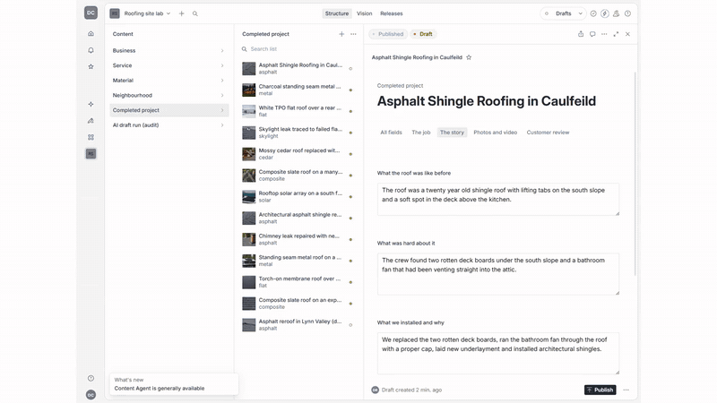

# Roofing Site Lab

[](https://github.com/Exalt24/roofing-site-lab/actions/workflows/test.yml)



*Left to right in the clip: an AI-written draft waiting for a person in Sanity Studio, then the live static site that is built from the same content. [Full quality mp4](docs/demo.mp4).*

Astro and Sanity reference site for a roofing contractor, with AI drafts for human review. Sample data. Live site: https://seabreeze-roofing-lab.pages.dev

**Everything here is sample data.** "Seabreeze Roofing & Solar" is a sample company. The jobs, people, reviews, licence and insurance details, phone number and addresses are sample content. Every photograph is a synthetic image generated locally (SDXL through ComfyUI) with its metadata stripped. The clips are 6 second synthetic placeholders. **The quote form on the live sample is a display form** (the page says so and the button is disabled). The lead receiver is built and tested here and runs locally.

For the person who would run this for a real company, start with [docs/HANDOVER.md](docs/HANDOVER.md).

## What it does

A roofer's crew finishes a job, picks the photos and fills a short intake (what the roof was like, what was hard, what was installed). The system turns that into a draft project page in Sanity Studio. A person reads it, fixes it and presses Publish. The site is rebuilt as static HTML from the published content.

- **Content model, one entry per job.** A completed project is entered once. Service, material and neighbourhood pages are derived from the projects, so they cannot drift apart. A neighbourhood page only exists when it has at least 2 finished projects and at least 25 words of local facts. Otherwise the page is not generated and the build log says why.
- **Local SEO basics.** One business entry (name, address, phone, areas served, profile links) feeds every page and its `RoofingContractor` structured data. The details a Google Business Profile lists cannot differ from the site's. The area pages carry real local facts, and Search Console and Bing Webmaster Tools are verified on the sample.
- **Build gates.** The build refuses to ship when the page graph breaks: orphan pages, dead links, or near-duplicate pages. It also refuses an area page that could be swapped for another area by changing the place name (swap test). Each gate has a test that fails when the gate is removed.
- **AI drafting with a human in the loop.** The model writes only structured JSON against a schema, from a facts ledger with ids. Each section has to cite the entered facts it used (citation is per section, not per sentence). Deterministic validators then check numbers, names, materials, banned claims, personal data, lengths, near-duplicates and a prompt-injection canary. Missing details are computed in code and shown as "missing information" instead of being filled in by the model. The writer refuses any document id outside `drafts.` (a code guard with tests). The Sanity token itself is not scoped, because the free plan has no create-only role. So the model's text reaches the site only when a person publishes it, and a re-run never overwrites a draft someone has edited.
- **What the AI step receives.** The job's entered fields, the staff notes and photo captions, and the photos. The private block (customer name, phone, email, street address) is never sent. If an employee types one of those into a free-text box anyway, the intake is refused before any model call and the message names the box. Uploaded photos have their EXIF (GPS, device, time) removed first. The default model runs locally through Ollama, so nothing leaves the machine. A hosted model is an option the company would have to choose.
- **Call tracking plumbing.** A webhook receiver for CallRail's post-call format (HMAC-SHA1 `Signature` header, checked against the RFC 2202 test vector). It normalises phone numbers to E.164 and pulls click ids from the landing page URL. A SQLite ledger takes idempotent inserts. The raw payload is cut down to an allow-list of fields. The lead row itself keeps the phone number in E.164, the landing page URL and the GA client id. An outbox with backoff gives up after 12 tries. A daily retention purge zeroes the deleted rows in the file and vacuums it. When `CALLRAIL_API_KEY` and `CALLRAIL_ACCOUNT_ID` are set, a reconcile runs at start-up and nightly, because CallRail does not resend failed webhooks. `npm run start -w packages/tracking` runs it. Output goes to GA4 (Measurement Protocol) and to Google Ads through the **Data Manager API**. New offline-conversion work can no longer use the Google Ads API upload route (restricted from 2026-06-15). The Ads builder measures click age to the day of the upload and drops a click id older than 90 days. It stops matching on phone and email after 63. It builds requests with `validateOnly` on by default.
- **Site.** Astro 7, static output, images from Sanity's CDN with `auto=format`, and JSON-LD for the business, articles, videos and breadcrumbs. There is no FAQ markup and no self-written review stars (Google ended FAQ rich results and ignores a business's reviews of itself). Every page has a credentials bar. Consented customer reviews are shown on the page, with before / during / after photo labels. Phones get a one-tap call and quote bar. There is also a skip link, a 404 page, share tags, a privacy page, and a quote form that states its purpose.
- **Privacy built in.** The quote form stores the version of the privacy notice the person saw. It keeps marketing email and ad measurement each behind their own separate, unticked box. Without the measurement box, the ad click id, landing page and Google visitor number are dropped, and no Google upload can be built from that lead. A review only renders when its consent flag is true. Published images are checked for metadata. This was written against BC's PIPA, CASL and Google's own policies as read on 2026-10-12, and a second reviewer checked each cited section against the statutes. It is not legal advice, and the privacy page still needs a lawyer.

## Register (what was run, and against what)

- **Tests:** 269 across five packages, run by CI, with mutation checks on the build gates, the validators, the receiver and the redirect tool. Counts per group are in [docs/REGISTER.md](docs/REGISTER.md).
- **Drafter evaluation:** 13 sample jobs on a local model. One was refused at intake (private details typed in the notes). 12 were sent to the model, and 11 were ready for review, 10 of them on the first attempt. One was left with a person. The model is not deterministic, so read the first-attempt count as a range.
- **Run against stand-ins built from the vendors' documentation:** the CallRail receiver and its nightly reconcile (recorded-shape payloads), number swapping (a simulator written for this repo), and the Google Ads payloads (built to the documented shape with `validateOnly` on by default). GA4 payloads are accepted by Google's own validation server. The click redirect and postback endpoint are tested through a local HTTP round trip and seeded random worlds on sample data. They cover macros for click ID, sub IDs, payout, status and transaction ID, offer rotation, a 30 day attribution window, and a reject that is final. Pages that load Tag Manager set Consent Mode v2 to denied before it loads, and the quote form's measurement box updates it. The exported container is versioned in [docs/gtm-versions.md](docs/gtm-versions.md). Version 3 is the published one in a test Tag Manager account, and version 4 is the current export in this repo. Tagging runs in the browser here.
- **Connected on the live sample, on a test Google account:** GA4, Tag Manager, Search Console and Bing Webmaster Tools.
- **Redirect map tool:** 42 tests, a manual breakage pass (not saved, so not repeatable), and the output served by Cloudflare's local Pages runtime. It was run against a sample old site.
- **The writer guard:** the draft writer refuses any id outside `drafts.` in code. The Sanity token itself is not scoped.

The full table, the known limits of the drafter and of the receiver, and what CallRail's own integrations overlap with: [docs/REGISTER.md](docs/REGISTER.md). How to check each tracking step: [docs/VERIFY.md](docs/VERIFY.md). Cost estimate: [docs/COSTS.md](docs/COSTS.md).

## Speed

Lighthouse 13.5.0 on the mobile profile, run against the live site on 2026-10-12 with Tag Manager and GA4 loaded, gave Accessibility, Best Practices and SEO of 100 on all six pages measured. Performance ran 90 to 100. The per-page table, the figures from before Tag Manager and the re-run notes are in [docs/speed.md](docs/speed.md).

Re-run with `node tools/lighthouse_run.mjs <url>`. Reports are not committed.

## Dates

Pages carry a publish or modified date only when the CMS recorded one (Sanity's created and updated times). The fixture build has none, so it claims none. It also leaves out the sitemap lastmod and video markup that need one.

## The sample's live content

The live site is built from the Sanity project, not from the fixture file. Changing `packages/content/src/sample.ts` changes the tests and the fixture build only. To change the live sample, run `node --experimental-strip-types tools/seed_sanity.mjs` and then the deploy. Both need the Sanity and Cloudflare settings.

## Run it

Needs Node 22.18 or newer and, for the site tests, a Chromium for Playwright. The tests run TypeScript directly. The suite ran on 24.18.0 locally and in CI, and 22.18.0 is the declared minimum.

```sh
npm install
npx playwright install chromium
npm test                      # 250 tests across five packages
npm run build                 # builds from fixtures when no Sanity project id is set
node tools/lighthouse_budget.mjs   # the performance budget CI runs after the build (about 25 seconds in CI)
```

GitHub Actions runs the same commands on every push to main and on every pull request.

Optional pieces, none needed for the commands above:

- **Drafting locally.** Install [Ollama](https://ollama.com) and pull `qwen3:14b` (the drafting model) and `qwen3.5:9b` (describes photos). `node tools/draft_to_sanity.mjs 1` then writes a draft for the first test job into your Sanity project. A hosted-model backend is written as an option (`packages/drafter/src/llm.ts`, needs `OPENROUTER_API_KEY`).
- **Image metadata.** `pip install pillow`, then `python tools/strip_image_metadata.py` before committing photos. Uploads made by the drafter are cleaned in code.
- **Receiver.** Run `npm run start -w packages/tracking` with `CALLRAIL_SIGNING_KEY` and `OWNER_EMAIL` set. The other settings are listed at the top of `packages/tracking/src/server.ts`.

### Run it against your own accounts

The tools that talk to Sanity and Cloudflare read these from the environment, or from a `KEY=VALUE` file named by `SECRETS_FILE` (`tools/_env.mjs`): `SANITY_PROJECT_ID`, `SANITY_TOKEN` (a token that can write documents), optional `SANITY_DATASET`, `CLOUDFLARE_API_TOKEN`, `CLOUDFLARE_ACCOUNT_ID` and `PAGES_PROJECT`. Then:

```sh
node --experimental-strip-types tools/seed_sanity.mjs     # put the sample content into your Sanity project
cd studio && npm install && npm run deploy                          # your own Studio, after replacing the ids in sanity.cli.ts (studio/README.md)
node tools/deploy_pages.mjs                               # build from Sanity and deploy to your own Pages project
```

Set `PUBLIC_LEAD_ENDPOINT` when building to connect the quote form to a receiver. Set `PUBLIC_NOINDEX=true` for a staging site you do not want searched.

## Layout

```
packages/content    the content model, page graph and build gates
packages/drafter    intake -> facts ledger -> structured draft -> validators -> Sanity drafts
packages/tracking   call webhook receiver and server, ledger, outbox, reconcile, GA4 and Data Manager API builders, click redirect and postback endpoint
packages/redirects  old URLs to a Cloudflare Pages _redirects file, and a checker for chains, loops, live pages and the file limits
apps/site           Astro site and the CallRail swap simulator
studio              Sanity Studio schema
docs                HANDOVER.md (running it for a real company), VERIFY.md (how to check the tracking), REGISTER.md (the full register), COSTS.md, demo clip
tools               seeding, deploy, Lighthouse, screenshots, GA4 payload validation, image metadata, redirect map
```

Moving a site from a builder such as Duda onto this one, including the redirect map and the launch checklist: [docs/MIGRATION.md](docs/MIGRATION.md).

## Licence

MIT. The sample photographs and text carry no rights claim.
